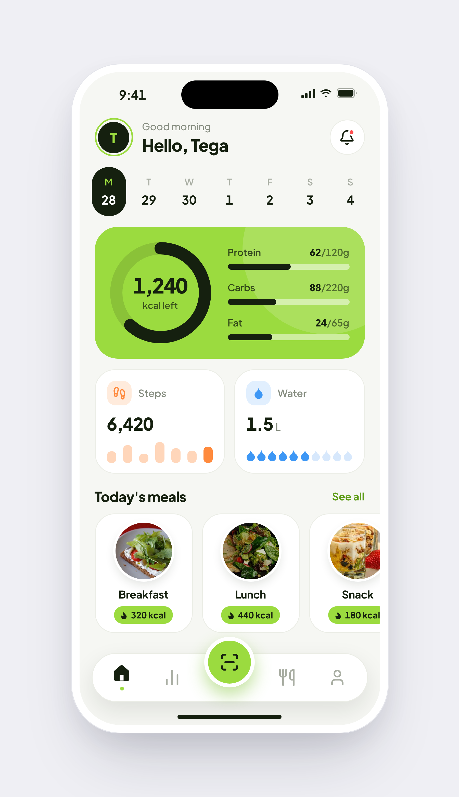

# Lozzit

Calorie tracker — home screen (Expo / React Native, Android first).



## Get the APK
Every push to `main` triggers the **Android APK** workflow (Actions tab). When it is green, open
**Releases → Lozzit APK (latest)** on your phone and install `lozzit.apk`
(allow installs from your browser when Android asks).
The APK is signed with the Expo debug key: fine for testing, not for the Play Store.

## Dev
```
npm install
npm run typecheck
npx expo start
```
Data on the home screen is hard-coded demo data (`src/screens/Home.tsx`).
Font: Plus Jakarta Sans. Icons: Lucide (ISC). Meal photos: Wikimedia Commons, CC BY-SA.
